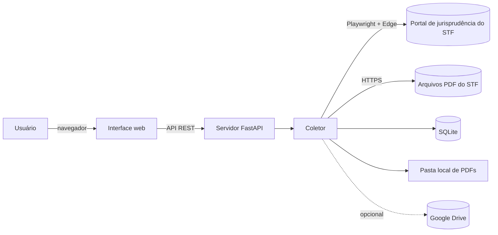

<div align="center">

# Coletor de Jurisprudência do STF

**Ferramenta local para pesquisa, coleta e organização de documentos jurisprudenciais públicos do Supremo Tribunal Federal**


</div>

> [!NOTE]
> **Declaração de uso de Inteligência Artificial.** Partes do código e da documentação deste projeto foram produzidas com o auxílio de ferramentas de Inteligência Artificial, sob revisão e responsabilidade do autor.

---

## Resumo

O acesso sistemático à jurisprudência é etapa recorrente da pesquisa jurídica, mas a obtenção manual de grandes volumes de decisões em portais oficiais é lenta, repetitiva e sujeita a erros de registro. Este projeto apresenta o **Coletor de Jurisprudência do STF**, uma aplicação de execução local que consulta o mecanismo de pesquisa oficial do Supremo Tribunal Federal, recupera o inteiro teor em PDF de acórdãos e decisões monocráticas quando disponível e organiza os arquivos por tipo de documento e ano de publicação. A ferramenta registra cada coleta em banco de dados local, o que permite acompanhar o andamento, retomar execuções interrompidas, evitar duplicidades por meio de *hash* criptográfico e auditar o histórico de eventos. O desenho privilegia o uso responsável da fonte: as consultas respeitam intervalo mínimo entre requisições e nenhuma proteção anti-robô do portal é contornada. Opcionalmente, os documentos podem ser enviados ao Google Drive do usuário.

**Palavras-chave:** jurisprudência; Supremo Tribunal Federal; coleta automatizada de dados; pesquisa jurídica empírica; dados públicos.

---

## Sumário

1. [Introdução](#1-introdução)
2. [Objetivos](#2-objetivos)
3. [Funcionalidades](#3-funcionalidades)
4. [Arquitetura e metodologia](#4-arquitetura-e-metodologia)
5. [Instalação](#5-instalação)
6. [Guia de uso](#6-guia-de-uso)
7. [Integração com o Google Drive](#7-integração-com-o-google-drive)
8. [Referência técnica](#8-referência-técnica)
9. [Validação e testes](#9-validação-e-testes)
10. [Limitações e considerações éticas e legais](#10-limitações-e-considerações-éticas-e-legais)
11. [Solução de problemas](#11-solução-de-problemas)
12. [Glossário](#12-glossário)
13. [Como citar](#13-como-citar)
14. [Licença](#14-licença)
15. [Referências](#15-referências)

---

## 1. Introdução

A publicidade dos julgamentos do Poder Judiciário é garantia constitucional (Constituição Federal, art. 93, IX), e o Supremo Tribunal Federal disponibiliza seus julgados em um portal de pesquisa de jurisprudência. Esse portal, contudo, foi concebido para consultas individuais: quem precisa reunir dezenas ou centenas de documentos sobre um tema, como ocorre em revisões de literatura jurídica, estudos de caso e pesquisas empíricas em Direito, precisa abrir cada resultado e baixar cada arquivo manualmente.

O **Coletor de Jurisprudência do STF** automatiza essa etapa operacional. A partir de palavras-chave e de filtros opcionais, ele executa a mesma pesquisa que o usuário faria no portal, percorre todas as páginas de resultados e salva os PDFs de inteiro teor em uma estrutura de pastas previsível. O pesquisador mantém o controle sobre a consulta e recebe, ao final, um acervo organizado e um registro verificável de como ele foi obtido.

A aplicação é executada inteiramente no computador do usuário. Não há servidor remoto, cadastro ou envio de dados a terceiros, salvo a integração opcional com o Google Drive da própria pessoa.

## 2. Objetivos

### 2.1 Objetivo geral

Oferecer um meio acessível, reprodutível e responsável de coletar documentos jurisprudenciais públicos do STF para fins de estudo e pesquisa.

### 2.2 Objetivos específicos

- Permitir a pesquisa por palavras-chave, tipo de documento, período de publicação e classe processual, usando o mecanismo oficial do tribunal.
- Baixar e organizar automaticamente os PDFs de inteiro teor disponíveis.
- Garantir a **rastreabilidade** da coleta, com filtros, contadores e eventos registrados em banco de dados local.
- Garantir a **resiliência** do processo, permitindo retomar coletas interrompidas a partir do último ponto salvo.
- Evitar arquivos duplicados por meio da comparação do conteúdo.
- Tornar a ferramenta utilizável por pessoas sem formação em tecnologia, com instalação por clique duplo e interface gráfica no navegador.

## 3. Funcionalidades

| Recurso | Descrição |
| --- | --- |
| Pesquisa oficial | Usa o mecanismo de busca do portal de jurisprudência do STF, com os mesmos operadores e regras. |
| Tipos de documento | Acórdãos e decisões monocráticas. |
| Filtros | Período de publicação (data inicial e final) e classe processual (por exemplo, `RE`). |
| Organização automática | Pastas por tipo de documento e ano de publicação. |
| Deduplicação | Arquivos idênticos são reconhecidos pelo *hash* SHA-256 e não são salvos duas vezes. |
| Retomada | Coletas interrompidas continuam da página em que pararam. |
| Fila de coletas | Novas pesquisas aguardam a conclusão da coleta em andamento. |
| Registro de eventos | Cada coleta mantém um histórico consultável de avisos e erros. |
| Pasta configurável | O usuário escolhe onde os PDFs são salvos e pode abri-la pela interface. |
| Google Drive (opcional) | Envio dos PDFs para uma pasta do Drive do usuário. |
| API documentada | Interface REST com documentação interativa (OpenAPI). |

## 4. Arquitetura e metodologia

### 4.1 Visão geral

A aplicação segue uma arquitetura cliente-servidor local. O servidor, escrito em Python com FastAPI, atende apenas o próprio computador (`127.0.0.1`) e expõe uma interface web e uma API REST. A pesquisa é realizada por um navegador controlado pelo Playwright, e o estado das coletas é persistido em SQLite.



### 4.2 Componentes

| Módulo | Responsabilidade |
| --- | --- |
| `app/main.py` | Rotas da API, inicialização e entrega da interface. |
| `app/collector.py` | Orquestra a coleta: paginação, *checkpoints*, deduplicação, organização e envio ao Drive. |
| `app/stf_browser.py` | Abre o portal do STF em um navegador real, aplica filtros e captura os resultados da pesquisa. |
| `app/stf.py` | Normaliza os resultados do portal em um formato interno de documento. |
| `app/downloader.py` | Baixa os PDFs com limite de tamanho, novas tentativas e mensagens de erro claras. |
| `app/organizer.py` | Define o caminho de cada arquivo (`STF/<tipo>/<ano>/<título>_<chave>.pdf`). |
| `app/database.py` | Persistência em SQLite: coletas, documentos, eventos e configurações. |
| `app/drive.py` | Autorização OAuth e envio de arquivos ao Google Drive. |
| `app/models.py` | Modelos de dados e validação das requisições. |
| `app/config.py` | Configurações lidas do ambiente ou do arquivo `.env`. |
| `app/static/index.html` | Interface gráfica (HTML, CSS e JavaScript sem *frameworks*). |

### 4.3 Procedimento de coleta

Cada coleta segue as etapas abaixo:

1. **Registro.** A requisição é validada (as palavras-chave são obrigatórias) e gravada no banco com estado `queued`. Apenas uma coleta é executada por vez; as demais aguardam na fila.
2. **Pesquisa.** O coletor abre a página oficial de pesquisa do STF em um navegador e submete as palavras-chave. A requisição de busca emitida pela própria página é interceptada para definir a paginação e aplicar os filtros de data e de classe processual. Se o formato da consulta não for reconhecido, a coleta é interrompida em vez de produzir resultados fora dos filtros escolhidos.
3. **Validação dos resultados.** São aceitos apenas resultados da base correspondente ao tipo de documento, e os endereços dos PDFs precisam apontar para domínios oficiais do STF. Endereços `http` são convertidos para `https`.
4. **Paginação com *checkpoint*.** Os resultados são percorridos em páginas de 100 itens, com intervalo mínimo de 1 segundo entre consultas. Após cada página, a posição atual é salva, o que permite retomar a coleta exatamente desse ponto.
5. **Download.** Cada PDF é baixado com limite de tamanho (50 MiB por padrão). Falhas temporárias recebem novas tentativas com espera crescente. Respostas que não sejam PDF, arquivos vazios e verificações anti-robô são registrados como erro, sem novas tentativas.
6. **Deduplicação.** O *hash* SHA-256 de cada arquivo é comparado com o catálogo local; arquivos idênticos são marcados como repetidos e não são gravados novamente.
7. **Organização.** O arquivo é salvo em `STF/<tipo de documento>/<ano>/`, com o nome derivado do título e de uma chave única do documento.
8. **Envio opcional.** Se uma pasta do Drive foi escolhida, o arquivo é enviado para `STF/<tipo>/<ano>` dentro dela, sem duplicar arquivos já existentes na mesma pasta.
9. **Encerramento.** A coleta termina como `completed` ou `completed_with_errors`. Se o processo for fechado durante a execução, ela é marcada como `interrupted` na próxima inicialização e pode ser retomada.

### 4.4 Persistência e rastreabilidade

O banco `jurisprudencias.sqlite3` (modo WAL) contém as seguintes tabelas:

| Tabela | Conteúdo |
| --- | --- |
| `jobs` | Cada coleta: filtros, estado, contadores, *checkpoint* e datas. |
| `documents` | Catálogo de documentos: metadados, caminho local, *hash*, estado e identificador no Drive. |
| `job_documents` | Relação entre coletas e documentos, com o resultado de cada documento naquela coleta. |
| `events` | Registro cronológico de informações, avisos e erros de cada coleta. |
| `app_settings` | Preferências do usuário, como a pasta escolhida para os PDFs. |

Os estados possíveis de uma coleta são `queued` (na fila), `running` (em andamento), `completed` (concluída), `completed_with_errors` (concluída com erros) e `interrupted` (interrompida).

### 4.5 Tecnologias utilizadas

| Tecnologia | Uso no projeto |
| --- | --- |
| Python 3.12+ | Linguagem principal. |
| FastAPI e Uvicorn | Servidor web e API REST. |
| Pydantic | Validação de dados e configurações. |
| Playwright | Automação do navegador para a pesquisa no portal. |
| HTTPX | Download dos arquivos PDF. |
| SQLite | Banco de dados local. |
| Google API Client | Integração opcional com o Google Drive. |
| Pytest | Testes automatizados. |

## 5. Instalação

### 5.1 Requisitos

- Windows 10 ou 11 (instalação guiada), macOS ou Linux.
- Conexão com a internet durante as pesquisas e os downloads.
- Python 3.12 ou mais recente. No Windows, o instalador cuida disso automaticamente.
- Microsoft Edge (já incluído no Windows). Em outros sistemas, usa-se o Chromium do Playwright.

### 5.2 Windows (recomendado para usuários sem experiência técnica)

Não é preciso digitar comandos.

1. **Baixe o projeto.** Na [página do projeto no GitHub](https://github.com/HeitorReboucas/jurisprudencia-stf-downloader), clique em **Code › Download ZIP**. Clique com o botão direito no arquivo baixado, escolha **Extrair Tudo** e abra a pasta `jurisprudencia-stf-downloader-main`.
2. **Instale (somente na primeira vez).** Dê dois cliques em **`Instalar.bat`** e aguarde a mensagem **Pronto!**. Se o Python não estiver instalado, o instalador o instala pelo `winget`.
3. **Abra o programa.** Dê dois cliques em **`Abrir Coletor.bat`**. A página do coletor abre automaticamente no navegador.

> [!IMPORTANT]
> A janela preta aberta pelo `Abrir Coletor.bat` é o próprio programa em funcionamento. Mantenha-a aberta durante o uso e **feche-a para encerrar**. Se fechar apenas o navegador, abra o `Abrir Coletor.bat` novamente para voltar à página.

> [!TIP]
> Se o Windows exibir **"O Windows protegeu o computador"**, clique em **Mais informações › Executar assim mesmo**. O aviso aparece porque os arquivos foram baixados da internet. Depois de baixar uma versão nova do projeto, rode o `Instalar.bat` outra vez.

### 5.3 macOS e Linux

Em um terminal aberto na pasta do projeto:

```bash
python3 -m venv .venv
.venv/bin/python -m pip install -r requirements.txt
.venv/bin/python -m playwright install chromium
.venv/bin/python -m uvicorn app.main:app --host 127.0.0.1 --port 8000
```

Em seguida, acesse `http://127.0.0.1:8000` no navegador. Para encerrar, pressione **Ctrl+C** no terminal.

### 5.4 Instalação manual no Windows (desenvolvedores)

```powershell
py -3 -m venv .venv
.\.venv\Scripts\python.exe -m pip install -r requirements.txt
.\.venv\Scripts\python.exe -m uvicorn app.main:app --host 127.0.0.1 --port 8000
```

## 6. Guia de uso

### 6.1 Realizar uma pesquisa

No cartão **Nova pesquisa**:

1. Em **O que você procura?**, digite os termos da pesquisa (por exemplo, `mulheres e direito fundamental`). O campo é obrigatório; aspas e operadores seguem as regras do portal do STF.
2. Em **Tipo de documento**, marque **Acórdãos**, **Decisões monocráticas** ou ambos.
3. Opcionalmente, limite o **Período de publicação** com as datas **De** e **Até**.
4. Opcionalmente, informe a **Classe processual** (por exemplo, `RE`, `ADI`, `HC`).
5. Confira, em **Salvar em**, a pasta onde os PDFs serão gravados.
6. Clique em **Iniciar coleta**. O andamento aparece no cartão **Acompanhamento**.

Consultas sem filtro de data podem retornar muitos documentos e levar mais tempo. Uma nova coleta iniciada durante outra entra na fila automaticamente.

### 6.2 Interpretar os contadores

| Contador | Significado |
| --- | --- |
| **Encontrados** | Documentos retornados pela pesquisa. |
| **Baixados** | PDFs salvos no computador. |
| **No Drive** | PDFs enviados ao Google Drive. |
| **Repetidos** | PDFs idênticos a um arquivo já existente no catálogo. |
| **Erros** | Documentos não baixados ou não enviados; o motivo aparece no **Registro da coleta**. |

### 6.3 Histórico e retomada

O cartão **Histórico** lista as coletas anteriores. Ao selecionar uma delas, seus contadores e eventos são exibidos. Coletas **interrompidas** ou **concluídas com erros** podem ser continuadas pelo botão **Retomar coleta**, que reaproveita o *checkpoint* salvo.

### 6.4 Local dos arquivos

Por padrão, os dados ficam na pasta `data`, dentro da pasta do projeto:

```text
data/
├── downloads/
│   └── STF/
│       ├── Acórdãos/
│       │   └── 2024/
│       └── Decisões Monocráticas/
│           └── 2024/
└── jurisprudencias.sqlite3
```

No quadro **Salvar em**:

- **Abrir** mostra a pasta no explorador de arquivos (o botão **Abrir pasta dos PDFs**, no acompanhamento, faz o mesmo);
- **Alterar** permite informar o caminho completo de outra pasta (por exemplo, `C:\Users\voce\Documents\STF`), que é criada se não existir;
- **Voltar à pasta padrão** restaura `data/downloads`.

A escolha é salva e vale para as próximas coletas; os arquivos já baixados permanecem onde estão. O banco de dados e o token do Drive continuam em `data`.

> [!WARNING]
> Não apague o arquivo `jurisprudencias.sqlite3` se quiser preservar o histórico das coletas e a possibilidade de retomá-las.

## 7. Integração com o Google Drive

A integração é opcional; a pesquisa e o download funcionam sem ela. Para habilitá-la, é necessário criar credenciais próprias no Google Cloud:

1. Acesse o [Google Cloud Console](https://console.cloud.google.com/) e crie um projeto.
2. Habilite a **Google Drive API**.
3. Configure a tela de consentimento OAuth. Se o aplicativo ficar em modo de teste, adicione sua conta como usuária de teste.
4. Crie um identificador de cliente OAuth do tipo **Web application**.
5. Em **URIs de redirecionamento autorizados**, cadastre exatamente `http://localhost:8000/api/drive/oauth/callback`.
6. Baixe o JSON de credenciais e salve-o na pasta do projeto como `credentials.json`.
7. Com o programa aberto, clique em **Conectar Drive** e autorize o acesso.
8. Recarregue a página do coletor e escolha uma pasta em **Enviar também para o Google Drive**.

O token de autorização fica em `data/google-token.json`. O Google solicita permissão ampla ao Drive, não restrita à pasta escolhida; leia a tela de consentimento antes de aprovar e, se desejar, revogue o acesso depois nas configurações da sua Conta Google.

> [!CAUTION]
> Nunca compartilhe nem publique `credentials.json` ou o token. Esses arquivos já são ignorados pelo Git.

## 8. Referência técnica

### 8.1 API REST

Com o programa em execução, a documentação interativa (OpenAPI) fica disponível em `http://127.0.0.1:8000/docs`.

| Método e rota | Finalidade |
| --- | --- |
| `GET /api/health` | Verifica se o serviço está ativo. |
| `GET /api/content-types` | Lista os tipos de documento. |
| `POST /api/jobs` | Inicia uma coleta. |
| `GET /api/jobs` | Lista as coletas recentes. |
| `GET /api/jobs/{job_id}` | Consulta o estado de uma coleta. |
| `GET /api/jobs/{job_id}/events` | Consulta o registro de eventos. |
| `POST /api/jobs/{job_id}/resume` | Retoma uma coleta interrompida ou com erros. |
| `GET /api/documents` | Lista os documentos do catálogo local. |
| `POST /api/documents/{document_id}/upload` | Envia novamente um PDF local ao Drive. |
| `GET /api/downloads-folder` | Informa a pasta de destino dos PDFs. |
| `PUT /api/downloads-folder` | Altera essa pasta (`{"path": ""}` restaura a padrão). |
| `POST /api/downloads-folder/open` | Abre a pasta no computador. |
| `GET /api/drive/status` | Informa se o Drive está configurado e autorizado. |
| `GET /api/drive/auth/url` | Inicia a autorização do Drive. |
| `GET /api/drive/folders` | Lista as pastas disponíveis no Drive. |

Exemplo de requisição para `POST /api/jobs`:

```json
{
  "query": "mulheres e direito fundamental",
  "content_types": ["acordaos", "decisoes_monocraticas"],
  "date_from": "2020-01-01",
  "date_to": "2024-12-31",
  "process_class": "RE"
}
```

Os campos `query` e `content_types` são obrigatórios; os demais são opcionais. Os valores aceitos em `content_types` são `acordaos` e `decisoes_monocraticas`.

### 8.2 Configuração

As opções abaixo podem ser definidas em um arquivo `.env` na pasta do projeto (veja `.env.example`). Normalmente não é necessário alterá-las.

| Variável | Padrão | Descrição |
| --- | --- | --- |
| `DATA_DIR` | `data` | Pasta do banco de dados, do token do Drive e, salvo outra escolha na interface, dos PDFs. |
| `STF_TIMEOUT_SECONDS` | `90` | Tempo máximo para abrir o portal e receber a resposta da pesquisa. |
| `STF_REQUEST_DELAY_SECONDS` | `1.0` | Intervalo mínimo entre pesquisas (não pode ser inferior a 1 segundo). |
| `STF_MAX_ATTEMPTS` | `3` | Tentativas para downloads com falha temporária. |
| `STF_BROWSER_CHANNEL` | Edge no Windows; Chromium nos demais | Navegador usado pelo Playwright. Use `chromium` se o Edge não estiver disponível. |
| `DOWNLOAD_MAX_BYTES` | `52428800` | Tamanho máximo de cada PDF (50 MiB). |
| `DOWNLOAD_TIMEOUT_SECONDS` | `60` | Tempo máximo de espera por PDF. |
| `GOOGLE_CLIENT_SECRETS_FILE` | `credentials.json` | Arquivo de credenciais OAuth. |
| `GOOGLE_TOKEN_FILE` | `data/google-token.json` | Token salvo após a autorização. |
| `GOOGLE_REDIRECT_URI` | `http://localhost:8000/api/drive/oauth/callback` | Endereço de retorno da autorização do Google. |

### 8.3 Estrutura do repositório

```text
.
├── app/                 # código da aplicação (ver seção 4.2)
│   └── static/          # interface web
├── tests/               # testes automatizados
├── Instalar.bat         # instalador para Windows
├── Abrir Coletor.bat    # inicializador para Windows
├── requirements.txt     # dependências Python
├── .env.example         # modelo de configuração
├── CITATION.cff         # dados de citação
└── LICENSE              # licença MIT
```

## 9. Validação e testes

O projeto conta com 32 testes automatizados (Pytest) que cobrem a API, o fluxo de coleta, a persistência, o download e a integração com o portal. Os testes usam respostas simuladas e banco temporário; não exigem credenciais do Google nem fazem pesquisas reais no STF.

```bash
# Windows
.\.venv\Scripts\python.exe -m pytest -q

# macOS e Linux
.venv/bin/python -m pytest -q
```

Além dos testes automatizados, o comportamento foi verificado com coletas reais no portal do STF, abrangendo paginação, filtros de data, fila de coletas, retomada e tratamento de erros, e com testes de caixa-preta da interface.

## 10. Limitações e considerações éticas e legais

### 10.1 Limitações conhecidas

- **Verificação anti-robô.** O servidor de arquivos do STF pode exigir uma verificação anti-robô antes de liberar o PDF, o que ocorre com frequência nos acórdãos. A ferramenta **não contorna** essa proteção: o documento é registrado com erro e pode ser baixado manualmente pelo portal.
- **Disponibilidade do inteiro teor.** Nem todo resultado tem PDF disponível, e alguns arquivos são servidos vazios pelo próprio portal. Súmulas e informativos não são oferecidos porque o portal não disponibiliza PDF de inteiro teor para eles.
- **Dependência do portal.** A coleta depende do funcionamento e do formato atual do portal do STF. Mudanças no portal podem exigir atualização do código de integração; nesse caso, a coleta é interrompida com uma mensagem explicativa, em vez de produzir dados incorretos.
- **Datas.** Os filtros consideram a data de **publicação**, que pode ser diferente da data de julgamento.

### 10.2 Uso responsável

- A ferramenta acessa apenas informações públicas, pelos canais oficiais do tribunal, e respeita intervalo mínimo entre as consultas.
- Não há tentativa de burlar CAPTCHA, bloqueios ou outros controles de acesso.
- O serviço é destinado a uso local e não possui autenticação própria. Mantenha-o restrito a `127.0.0.1` e não o exponha à internet.
- Cabe ao usuário observar os termos de uso do portal do STF e a legislação aplicável, inclusive a Lei Geral de Proteção de Dados (Lei nº 13.709/2018) no tratamento de eventuais dados pessoais presentes nas decisões.
- Os documentos coletados não substituem a consulta à fonte oficial para fins processuais.

## 11. Solução de problemas

<details>
<summary><strong>A instalação não termina</strong></summary>

- Verifique a conexão com a internet e execute o `Instalar.bat` novamente.
- Se o Python não for instalado automaticamente, instale o Python 3.12 ou mais recente pelo [site oficial](https://www.python.org/downloads/), marcando **Add python.exe to PATH**, e execute o `Instalar.bat` outra vez.
- Se o erro persistir, apague a pasta `.venv` dentro do projeto e repita a instalação.

</details>

<details>
<summary><strong>A página não abre</strong></summary>

- Abra o `Abrir Coletor.bat` novamente e aguarde alguns segundos.
- Se a janela informar que o programa não foi instalado, execute o `Instalar.bat` antes.
- Se a janela mostrar um erro sobre a porta 8000, outro programa a está usando. Feche-o ou reinicie o computador.
- Com a janela aberta, também é possível acessar `http://127.0.0.1:8000` manualmente.

</details>

<details>
<summary><strong>A pesquisa terminou sem documentos</strong></summary>

- Confira os termos, o tipo de documento e o período escolhidos. As datas referem-se à publicação.
- No Windows, confirme que o Microsoft Edge está instalado. Em outros sistemas, execute `.venv/bin/python -m playwright install chromium`.
- Se usar o Chromium do Playwright no Windows, adicione `STF_BROWSER_CHANNEL=chromium` ao arquivo `.env`.

</details>

<details>
<summary><strong>A coleta ficou "Interrompida"</strong></summary>

O portal do STF pode responder temporariamente sem resultados (por exemplo, com HTTP 202), inclusive por controle de tráfego. O programa registra a interrupção e não tenta contornar a proteção. Aguarde alguns minutos, selecione a coleta no **Histórico** e clique em **Retomar coleta**.

Se o registro informar que os filtros de data e classe não puderam ser aplicados, o formato da pesquisa do portal mudou e o código de integração precisa ser atualizado.

</details>

<details>
<summary><strong>Um documento aparece com erro</strong></summary>

Abra o **Registro da coleta** para ver o motivo específico. Os casos mais comuns são a verificação anti-robô (ver seção 10.1) e documentos sem PDF disponível. A coleta prossegue com os demais documentos.

</details>

<details>
<summary><strong>O Google Drive não conecta ou o envio falha</strong></summary>

Confira as credenciais, o endereço de retorno cadastrado no Google Cloud, a autorização no navegador e a pasta escolhida. O programa precisa estar na porta 8000 para a autorização funcionar. Se o envio falhar, o PDF continua salvo no computador e pode ser reenviado depois.

</details>

## 12. Glossário

| Termo | Definição |
| --- | --- |
| **Acórdão** | Decisão colegiada de um tribunal. |
| **Decisão monocrática** | Decisão proferida individualmente por um ministro. |
| **Inteiro teor** | Texto integral do documento, disponibilizado pelo STF em PDF. |
| **Classe processual** | Categoria do processo, como `RE` (Recurso Extraordinário) ou `ADI` (Ação Direta de Inconstitucionalidade). |
| **Coleta** | Uma pesquisa e o processamento de todos os documentos encontrados. |
| ***Checkpoint*** | Ponto salvo do andamento, usado para retomar uma coleta. |
| ***Hash* SHA-256** | Identificador calculado a partir do conteúdo do arquivo; arquivos idênticos têm o mesmo *hash*. |
| **API** | Interface que permite a outros programas utilizar o coletor. |
| **OAuth** | Protocolo pelo qual o Google solicita autorização para o acesso ao Drive. |

## 13. Como citar

Se este software contribuiu para a sua pesquisa, cite-o da seguinte forma. O arquivo [CITATION.cff](CITATION.cff) também habilita o botão **Cite this repository** na página do projeto no GitHub.

**ABNT (NBR 6023:2018)**

> REBOUÇAS, Heitor Alves. **Coletor de Jurisprudência do STF**: ferramenta local para coleta de documentos jurisprudenciais do Supremo Tribunal Federal. Versão 1.0.0. [S. l.], 2026. Software. Disponível em: https://github.com/HeitorReboucas/jurisprudencia-stf-downloader. Acesso em: dia mês ano.

**BibTeX**

```bibtex
@software{reboucas_coletor_stf_2026,
  author  = {Rebouças, Heitor Alves},
  title   = {Coletor de Jurisprudência do STF},
  version = {1.0.0},
  year    = {2026},
  url     = {https://github.com/HeitorReboucas/jurisprudencia-stf-downloader},
  license = {MIT}
}
```

## 14. Licença

Este projeto é distribuído sob a **Licença MIT**: o código pode ser usado, modificado e redistribuído livremente, inclusive em outros projetos, desde que se mantenham o aviso de direitos autorais e o texto da licença. Consulte o arquivo [LICENSE](LICENSE) para os termos completos.

A licença abrange apenas o código e a documentação deste repositório. Os documentos coletados são atos oficiais do Supremo Tribunal Federal e, nos termos do art. 8º, IV, da Lei nº 9.610/1998, não são objeto de proteção por direito autoral.

## 15. Referências

BRASIL. [Constituição (1988)]. **Constituição da República Federativa do Brasil de 1988**. Brasília, DF: Presidência da República, 1988. Disponível em: https://www.planalto.gov.br/ccivil_03/constituicao/constituicao.htm.

BRASIL. **Lei nº 9.610, de 19 de fevereiro de 1998**. Altera, atualiza e consolida a legislação sobre direitos autorais. Brasília, DF: Presidência da República, 1998. Disponível em: https://www.planalto.gov.br/ccivil_03/leis/l9610.htm.

BRASIL. **Lei nº 12.527, de 18 de novembro de 2011**. Regula o acesso a informações. Brasília, DF: Presidência da República, 2011. Disponível em: https://www.planalto.gov.br/ccivil_03/_ato2011-2014/2011/lei/l12527.htm.

BRASIL. **Lei nº 13.709, de 14 de agosto de 2018**. Lei Geral de Proteção de Dados Pessoais (LGPD). Brasília, DF: Presidência da República, 2018. Disponível em: https://www.planalto.gov.br/ccivil_03/_ato2015-2018/2018/lei/l13709.htm.

FASTAPI. **FastAPI documentation**. Disponível em: https://fastapi.tiangolo.com/.

MICROSOFT. **Playwright for Python**. Disponível em: https://playwright.dev/python/.

SQLITE. **SQLite documentation**. Disponível em: https://www.sqlite.org/docs.html.

SUPREMO TRIBUNAL FEDERAL. **Pesquisa de jurisprudência**. Brasília, DF: STF. Disponível em: https://jurisprudencia.stf.jus.br/.
